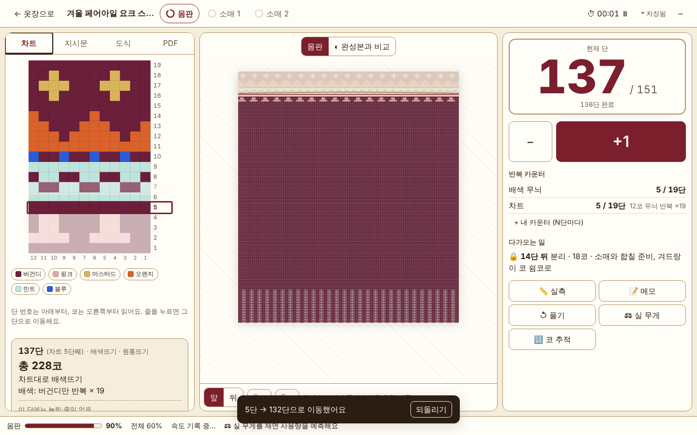
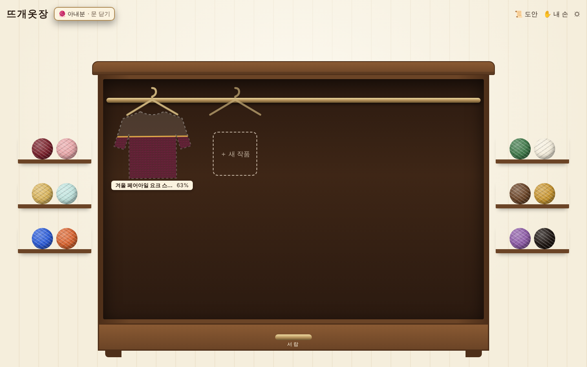
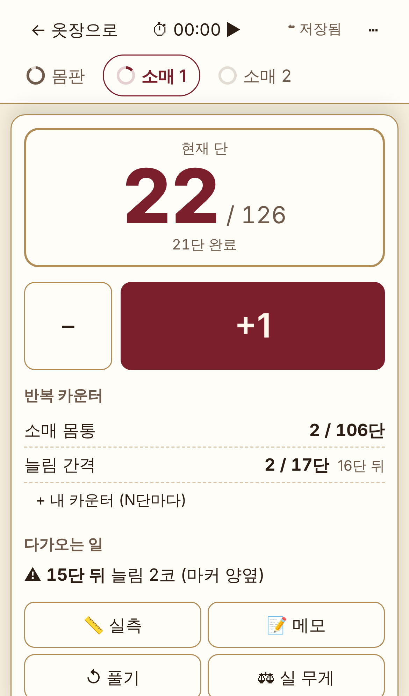
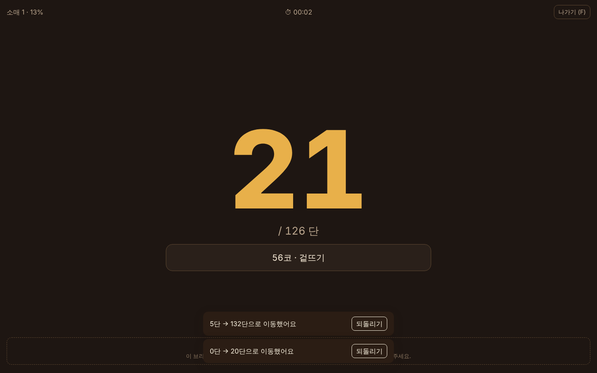
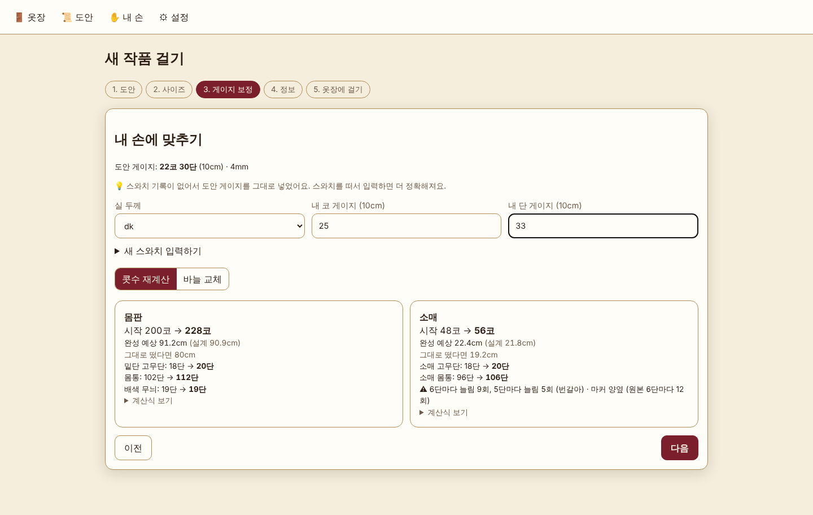

# 뜨개옷장 (KnitCloset) 🧶

도안을 내 손에 맞게 바꿔 주고, 뜨는 과정을 옷장 속 옷처럼 지켜보게 해 주는 나만의 뜨개 작업실.

| 작업 화면 (맥북·아이패드) | 옷장 |
|---|---|
|  |  |

| 아이폰 | 집중 모드 | 내 손에 맞추기 |
|---|---|---|
|  |  |  |

## 무엇을 하나요

- **게이지 보정**: 도안 게이지(작가의 손)를 내 손 게이지로 바꿔 콧수·단수·늘림 횟수와 간격을 다시 계산해요. 배색 반복 단위도 지켜요.
  예) 22코 도안을 25코 손으로 → 200코는 228코, "6단마다 2코 × 12회"는 "79단에 14회"
- **작업 화면**: 차트(자석자)와 니트 시뮬레이션, 큰 단 카운터, 다가오는 늘림·분리 알림, 집중 모드, 페이지 터너, 오프라인 동작
- **옷장**: 진행 중인 작품이 옷걸이에 걸려 진척도만큼 채워져요. 서랍에 보관하고 다시 꺼낼 수 있어요.
- **손 프로필 학습**: 완성 실측을 넣을수록 다음 작품의 게이지 추천이 정확해져요.
- **AI 도안** (선택): PDF 도안을 구조화하거나 새 도안을 만들어요. 결과는 항상 사람이 검수한 뒤 저장해요.

## 시작하기

```bash
pnpm install
pnpm test     # 전체 테스트
pnpm dev      # http://127.0.0.1:8787
```

맥북 상시 실행, Cloudflare Tunnel·Access, 아이패드 설치, 자동 백업은 **[docs/SETUP.md](docs/SETUP.md)** 를 따라 하면 돼요.

## 구조

```
apps/
  web/              React 19 + Vite PWA (옷장, 작업 화면, 마법사, 도안, 손 프로필, 설정)
  worker/           Hono on Cloudflare Workers + D1 + R2 (wrangler dev로 맥북에서 실행)
packages/
  gauge-engine/     게이지 변환, 늘림·줄임 재분배, 도안 → 단별 표, 진행 이벤트 재생, 보정 계수
  pattern-schema/   도안 JSON 스키마 (Zod) + 샘플 도안
  knit-render/      니트 렌더러 (옷장·작업 화면 공용)
scripts/            백업·복원, launchd 자동 실행, Tunnel 설정 예시, E2E 확인
docs/
  PLAN.md           통합 기획서
  SETUP.md          맥북 설치 가이드
```

| 명령 | 설명 |
|---|---|
| `pnpm dev` | 웹 빌드 → DB 마이그레이션 → 서버 |
| `pnpm dev:web` | 화면 개발용 Vite (핫 리로드, `/api`는 8787로) |
| `pnpm test` / `pnpm typecheck` | 모든 패키지 테스트 / 타입 검사 |
| `pnpm backup` / `pnpm restore <파일>` | 백업 / 되돌리기 |
| `pnpm start` | 운영 실행 (launchd가 사용) |

기획서 대비 구현 현황은 [docs/PLAN.md의 "구현 현황"](docs/PLAN.md#구현-현황-20261114)을 보세요.
